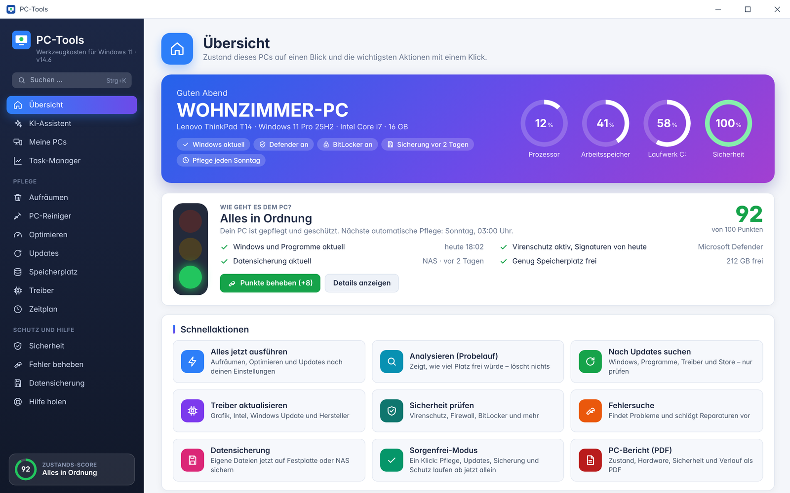
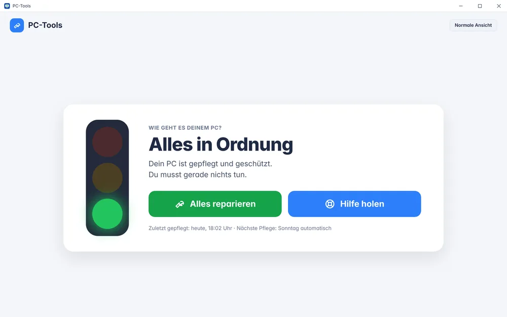
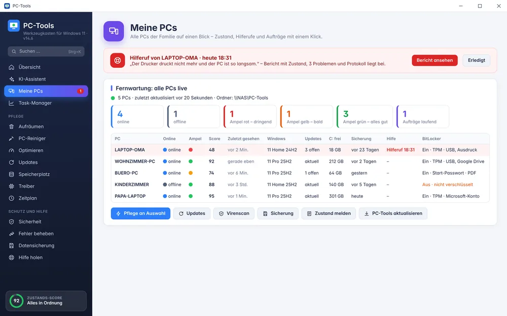
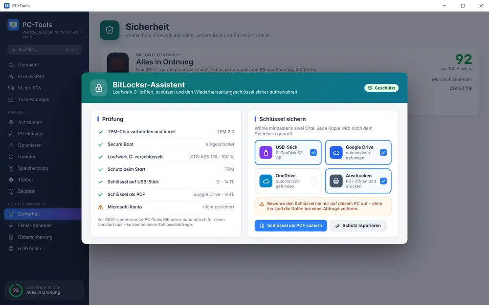
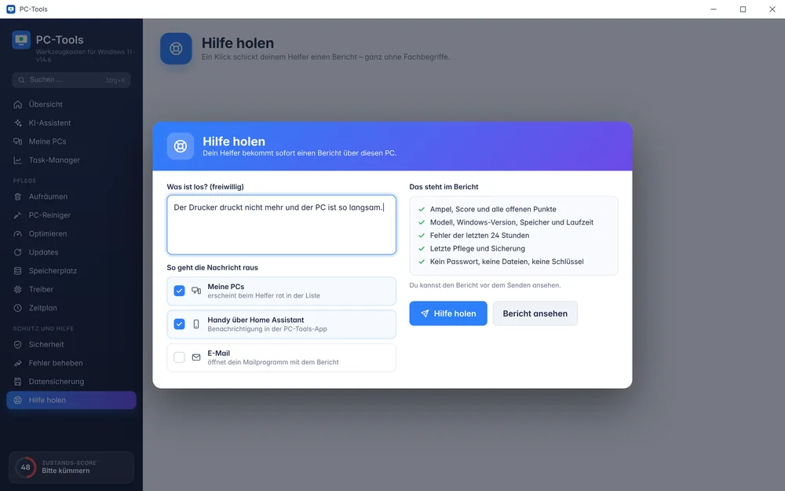
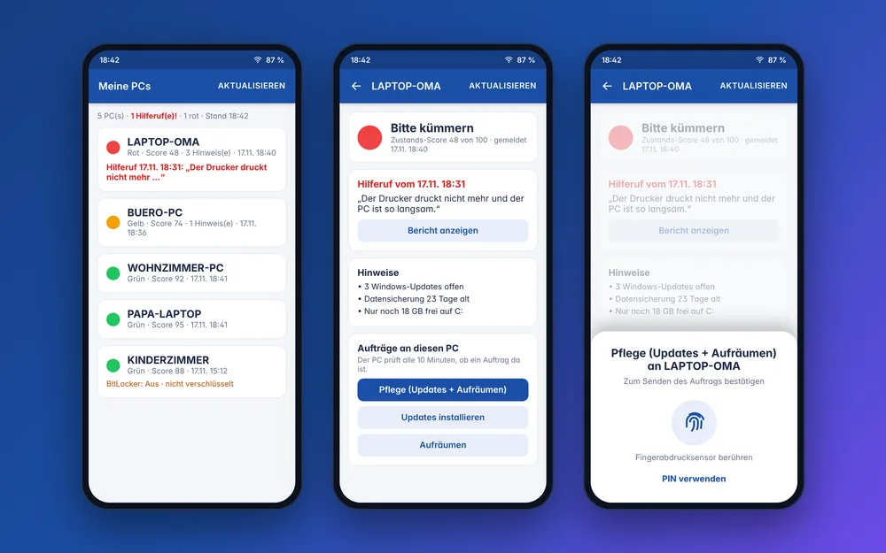

# PC-Tools

[](https://github.com/rhedv42-sudo/pc-tools/releases/latest)
[](https://rhedv42-sudo.github.io/pc-tools/)
[](LICENSE)
[](https://github.com/rhedv42-sudo/pc-tools/stargazers)

**[⬇ Download](https://github.com/rhedv42-sudo/pc-tools/releases/latest)** · **[Webseite](https://rhedv42-sudo.github.io/pc-tools/)** · **[Fragen & Ideen](https://github.com/rhedv42-sudo/pc-tools/discussions)** · Gefällt es dir? Ein ★ hilft anderen, PC-Tools zu finden.

<p align="center"><a href="https://rhedv42-sudo.github.io/pc-tools/#bilder"></a></p>

<table><tr>
<td width="33%"><br><b>Einfach-Modus</b> – eine Ampel, zwei Knöpfe</td>
<td width="33%"><br><b>Meine PCs</b> – die ganze Familie im Blick</td>
<td width="33%"><br><b>BitLocker-Assistent</b> – Schlüssel sicher, auch als PDF</td>
</tr><tr>
<td><br><b>Hilfe holen</b> – Bericht an den Helfer mit einem Klick</td>
<td colspan="2"><br><b>Android-App</b> – Hilferufe und Aufträge über Home Assistant</td>
</tr></table>

<sub>Abbildungen: nachgebaute Darstellungen der Oberfläche (Version 14.6) mit Beispieldaten.</sub>

Kostenloses, quelloffenes Wartungs- und Diagnosewerkzeug für Windows 10/11 und Windows Server
(PowerShell + WPF, eine einzige nachvollziehbare Skriptdatei).

- **Pflege:** Aufräumen, Optimieren, Windows-, Treiber-, Programm- und Store-Updates (winget, optional Chocolatey/Ninite Pro)
- **Reparatur:** Fehlersuche mit Ursache, Dienste, Store-Apps, Geräte-Manager, Windows-Reparatur (DISM/SFC/WinRE), Komplett-Reparatur
- **Sicherheit:** Virenschutz-, Firewall- und BitLocker-Prüfung, Sicherheitslücken in installierter Software, Netzwerk-Sicherheit
- **Netzwerk:** Diagnose, WLAN-Optimierung, Netzwerk-Dokumentation mit PDF-Bericht (Geräte, Router, Access Points, Smart Home/KNX)
- **Sicherung:** Datensicherung, Komplettsicherung, PC-Umzug, Notfall-Stick
- **Einrichten:** neue PCs, Apps entfernen, Tuning, nicht genutzte Programme entfernen u.v.m.

Alle Änderungen werden vorher angezeigt bzw. bestätigt, Wichtiges wird gesichert (Wiederherstellungspunkt,
Registry-Sicherung, Papierkorb). Es gibt keine Telemetrie – siehe [DATENSCHUTZ.md](DATENSCHUTZ.md).

Die Sicherheits- und Netzwerkprüfungen dienen dem **Finden und Beheben** von Schwachstellen im eigenen Netz –
PC-Tools ist kein Angriffswerkzeug: [ZWECK.md](ZWECK.md).

## Download und Installation

1. Neueste `PC-Tools-<Version>.zip` aus den [Releases](../../releases) laden und entpacken.
2. `PCPflege.cmd` doppelklicken (fragt nach Administratorrechten).
3. Beim ersten Start Lite oder Vollversion wählen.

Portabel (USB-Stick): `PC-Tools-<Version>-portabel.zip` entpacken und `PC-Tools starten.cmd` starten –
Einstellungen und Protokolle bleiben im Ordner `Daten` auf dem Stick.

**Deinstallation:** PC-Tools installiert keine Treiber oder Dienste. Entfernen in einer PowerShell als Administrator:

```powershell
Get-ScheduledTask | Where-Object { $_.TaskName -like 'PC-Tools*' -or $_.TaskName -like 'PC-Pflege*' -or $_.TaskName -like 'PCPflege*' } | Unregister-ScheduledTask -Confirm:$false
Remove-Item 'C:\ProgramData\PCPflege' -Recurse -Force
```
Danach ggf. die Desktop-Verknüpfung „PC-Tools“ löschen. (Eine Entfernen-Schaltfläche im Programm folgt mit Version 14.)

PC-Tools aktualisiert sich selbst aus diesem Repository (Zweig `stable`, nur veröffentlichte Versionen,
Prüfsumme in `version.json`). Abschaltbar unter *Einstellungen > Beim Start nach neuer Version suchen*.

## Ninite Pro (optional)

Ninite Pro ist lizenzierte Fremdsoftware und **nicht** Teil dieses Projekts. Programm-Updates laufen auch ohne
(winget). Wer eine eigene Lizenz hat: [Zubehoer/Ninite-Pro-einbinden.txt](Zubehoer/Ninite-Pro-einbinden.txt).

## Virenschutz-Fehlalarme

Große PowerShell-Skripte mit Systemfunktionen werden manchmal fälschlich gemeldet. Hintergrund und Meldeweg:
[SICHERHEIT.md](SICHERHEIT.md).

## Code signing policy

**Stand:** Die Programmdateien sind derzeit **nicht code-signiert** – deshalb warnt Windows SmartScreen beim ersten Start.
Eine kostenlose Open-Source-Signatur über die [SignPath Foundation](https://signpath.org) ist geplant, aber noch nicht erteilt.
Jede Version wird öffentlich per GitHub Actions aus diesem Quelltext gebaut. Richtlinie für die spätere Signatur: [CODE-SIGNING.md](CODE-SIGNING.md).

## Wer steckt dahinter

PC-Tools wird von René Hütt ([@rhedv42-sudo](https://github.com/rhedv42-sudo)) entwickelt und betreut – mit KI-Unterstützung
durch Claude (Anthropic). Ältere Commits stehen unter „Claude“, neuere unter René Hütt mit Claude als Mitautor.
Jede Version wird vor der Veröffentlichung auf echten PCs geprüft.

## Mitmachen

Fehler und Wünsche gern als [Issue](../../issues). Pull Requests werden vor dem Übernehmen geprüft.

## Lizenz

[Apache License 2.0](LICENSE) – © René Hütt (by RH).
